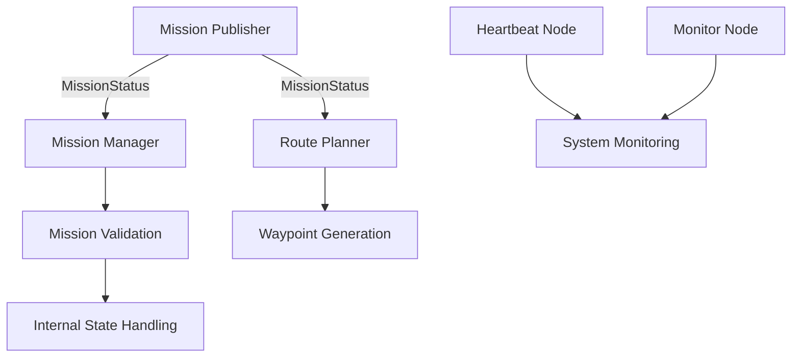

# AERIS
### Autonomous Exploration & Robotic Inspection System

**A modular, ROS 2-based robotics architecture for autonomous infrastructure inspection.**

AERIS is a simulation-first robotics software project exploring distributed robotic systems, mission coordination, route planning, and autonomous inspection workflows.

The project aims to establish a modular foundation for robotic inspection missions, with an initial focus on aerial infrastructure inspection.

---

## 1. Overview

AERIS is designed around the coordination of independent robotics software components through the Robot Operating System 2 (ROS 2).

The current implementation establishes a mission-processing pipeline that allows inspection missions to be published, validated, managed, and translated into waypoint sequences.

The architecture is being developed incrementally, starting with core communication and mission-management capabilities before introducing more advanced simulation and autonomy features.

## 2. Key Features

- **Distributed ROS 2 Architecture:** Independent nodes communicate through ROS 2 topics.
- **Custom Message Interfaces:** Structured mission data using a custom `MissionStatus` message.
- **Mission Management:** Mission validation, duplicate detection, and internal state handling.
- **Route Planning:** Deterministic generation of inspection waypoint sequences.
- **Modular Design:** Separate packages for core functionality and communication interfaces.
- **Simulation-First Development:** Designed to support future integration with robotics simulation environments.

## 3. System Architecture

The current mission-processing workflow:



Each component operates independently, supporting modular development and testing.

## 4. Mission Communication

AERIS uses a custom ROS 2 interface:

`aeris_interfaces/msg/MissionStatus`

```text
string mission_id
string target
string state
uint8 priority
uint32 waypoint_count
float32 progress
```

Example mission:

| Parameter | Value |
|---|---|
| Mission ID | `INSPECT-001` |
| Target | `BRIDGE_DECK_A` |
| State | `PLANNING` |
| Priority | `2` |
| Waypoints | `18` |
| Progress | `0.0` |

**ROS 2 Topic:** `/aeris/mission_status`

## 5. Route Planning

The route planner receives mission information and generates a sequence of inspection waypoints.

The current implementation uses deterministic straight-line waypoint generation.

Example output:

```text
Waypoint 1:  x=0.0,   y=0.0, z=10.0
Waypoint 2:  x=10.0,  y=0.0, z=10.0
Waypoint 3:  x=20.0,  y=0.0, z=10.0
...
Waypoint 18: x=170.0, y=0.0, z=10.0
```

This provides an initial foundation for future navigation and obstacle-aware planning capabilities.

## 6. Technology Stack

| Technology | Purpose |
|---|---|
| ROS 2 Jazzy | Robotics middleware |
| Python | Core robotics nodes |
| CMake | Interface package build configuration |
| ament_python | Python package build system |
| ament_cmake | ROS 2 interface package build system |
| colcon | Workspace build orchestration |
| Ubuntu 24.04 | Development environment |
| Git / GitHub | Version control |

## 7. Repository Structure

```text
AERIS/
├── ros2_ws/
│   └── src/
│       ├── aeris_core/
│       │   ├── aeris_core/
│       │   │   ├── heartbeat.py
│       │   │   ├── mission_publisher.py
│       │   │   ├── mission_manager.py
│       │   │   ├── monitor.py
│       │   │   └── route_planner.py
│       │   ├── package.xml
│       │   └── setup.py
│       │
│       └── aeris_interfaces/
│           ├── msg/
│           │   └── MissionStatus.msg
│           ├── CMakeLists.txt
│           └── package.xml
│
├── config/
├── docs/
├── scripts/
├── simulation/
├── src/
├── tests/
└── .gitignore
```

## 8. Getting Started

### Prerequisites

- Ubuntu 24.04
- ROS 2 Jazzy
- Python 3
- colcon

### Clone the repository

```bash
git clone https://github.com/ARYA-RAY-0/AERIS.git
cd AERIS
```

### Build the workspace

```bash
source /opt/ros/jazzy/setup.bash
cd ros2_ws
colcon build
```

### Source the workspace

```bash
source install/setup.bash
```

### Run the mission pipeline

Open separate terminals and source the ROS 2 environment and workspace in each one.

Mission publisher:

```bash
ros2 run aeris_core mission_publisher
```

Mission manager:

```bash
ros2 run aeris_core mission_manager
```

Route planner:

```bash
ros2 run aeris_core route_planner
```

Inspect mission messages:

```bash
ros2 topic echo /aeris/mission_status
```

## 9. Development Roadmap

- [x] ROS 2 workspace and package architecture
- [x] Custom mission message interface
- [x] Structured mission publisher
- [x] Mission validation and management
- [x] Duplicate mission detection
- [x] Initial waypoint generation
- [ ] Obstacle-aware route planning
- [ ] Robotics simulator integration
- [ ] UAV dynamics and flight-controller simulation
- [ ] Sensor and telemetry integration
- [ ] Mission execution and progress feedback
- [ ] Fault detection and recovery
- [ ] Expanded automated testing

## 10. Current Limitations

AERIS is currently an early-stage robotics software prototype.

The route planner generates deterministic straight-line waypoint sequences rather than performing obstacle-aware navigation. Mission state transitions are currently handled internally by the mission manager. Physical UAV control, flight-controller integration, and full simulator-based mission execution have not yet been implemented.

These capabilities form part of the planned development roadmap.

---

## Project Vision

The long-term goal of AERIS is to explore how distributed robotics software, intelligent mission coordination, and autonomous navigation can be combined into a scalable infrastructure inspection platform.

**AERIS — Engineering the foundations of autonomous robotic inspection.**
